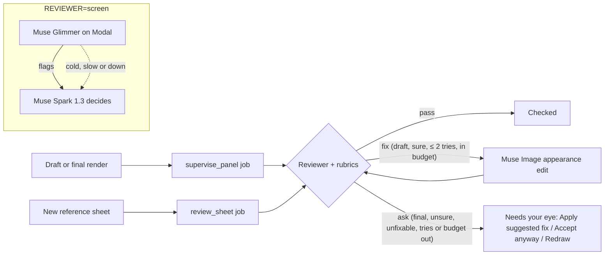
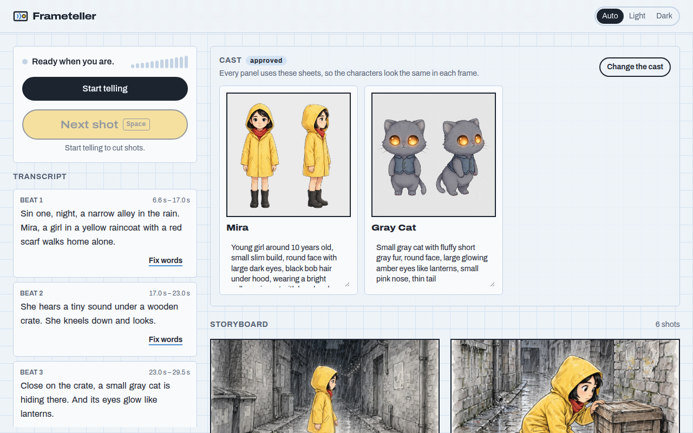
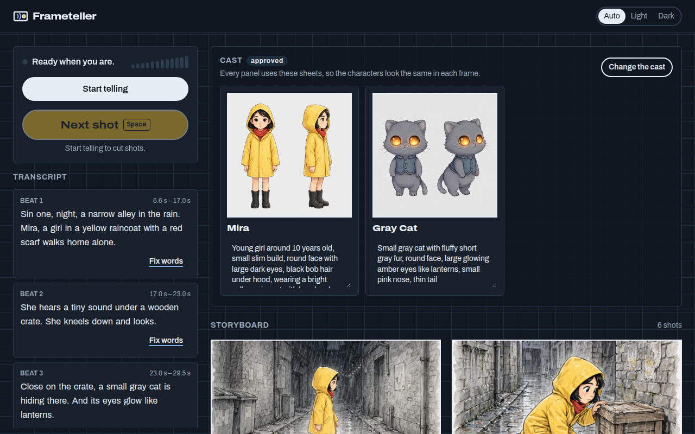

# Frameteller

**Frameteller turns spoken stories into editable storyboards and timed animatics.**

Talk through a scene. Frameteller listens live, works out the shots, draws consistent storyboard panels, lets you fix any panel by voice or by clicking an object in it, and exports an animatic timed to your own narration.

Built for indie filmmakers, YouTubers, animators, comic and game writers, and ad and pitch teams: anyone who can describe a scene faster than they can draw it.

> Built for the Meta Global AI Developer Hackathon (Indie Developer track, "Build for Your World").

- **Live demo:** TODO (production URL)
- **Studio on staging:** https://wonderful-field-0efc7e10f.3.azurestaticapps.net
- **Website and build log:** https://frameteller.com
- **Demo video:** TODO
- **Source:** https://github.com/njugTumz/frameteller

## How it works

| Step | Meta model | What it does |
|---|---|---|
| Hear | `muse-voice-transcribe-1.0` | Streams a live transcript with turn detection and speaker labels. |
| Direct | `muse-spark-1.3` | Turns transcript turns into a validated shot list and keeps a character bible. Routes voice edit commands. |
| Draw | `muse-image-1.0` | Generates a reference sheet per character, then every panel from those references so characters stay consistent. |
| Select | `sam-3.1` | Segments a clicked object so it can be moved, swapped or edited in isolation. |
| Check | Muse Glimmer (open weights, on our own GPU) with `muse-spark-1.3` | The continuity supervisor: reviews every reference sheet and panel against versioned rubrics, fixes drafts it can, and asks about the rest. |

The animatic is rendered with ffmpeg: each panel shows for its shot's spoken time (leading silence trimmed), and your own recording, kept only if you agree, is cut into the same segments so picture and voice stay in sync. Gentle camera moves by framing, short crossfades, optional subtitles, a title card and an end card ([ADR 0011](docs/adr/0011-animatic-export.md)).

Moving or resizing an object is saved on the panel: the first move asks Muse Image for a clean plate (the picture with only that object removed), and the server composites the SAM cut-out onto it at its new place ([ADR 0010](docs/adr/0010-clean-plates.md)). You can also download a storyboard sheet as a PDF and share a read-only link whose preview shows on X.

## Three ways to tell it

The start screen asks "How you'll tell it" ([ADR 0015](docs/adr/0015-script-mode.md)):

- **Narrate.** Make the story up out loud and press Space before each new shot. Muse Voice Transcribe streams the transcript, and the animatic uses your recording.
- **Teleprompter.** Paste a script, or upload a `.txt`, `.md` or `.fountain` file, then read it aloud while it scrolls. The current paragraph is highlighted and the next one is visible. Voice Transcribe follows along, and each paragraph is cut into a shot when you reach its end and pause. Matching is fuzzy, so misheard words still line up, and Space still works. The animatic uses your recording.
- **Read it to me.** Paste a script, choose one of five multilingual neural voices (each with a preview) and a language: English, French, Spanish, Hindi, Arabic or Portuguese. You don't speak. Azure Text-to-Speech reads each paragraph aloud in the browser while its shots are directed and drawn. For another language, Muse Spark translates the narration first, and the panels follow your original words. The animatic uses the synthesized narration, and the share page names the voice.

In both script modes each paragraph is one shot. Cues like "Wide shot." guide the camera. A line "Episode 2" starts a new episode with the same cast: shot numbers restart, and the storyboard groups shots by episode. In "Read it to me" the reading pauses after each episode until its draft panels are drawn ("Episode 2 is next"), then goes on by itself. The public demo takes scripts of up to 4,000 characters, 3 episodes and 12 shots per episode.

## Captions

Every animatic carries captions of what is actually said:

- **Narrate and Teleprompter:** the transcript, with your Fix words corrections.
- **Read it to me:** the script text.
- **Another language:** the translation, from Muse Spark.

Each shot's words are split into short lines of at most ten words, and each line is shown for its share of the shot by word count, so a line is never on screen longer than it is spoken. Captions come three ways:

- **Burned in:** large, on a soft dark backing, inside the bottom safe area. On by default, and always on for gallery and share-page videos.
- **A soft subtitle track** in the MP4 (`mov_text`, tagged with its language).
- **A downloadable `.srt`.**

"Captions in" picks another language for the captions alone. English, French, Spanish and Portuguese are burned in. Hindi and Arabic come as the soft track and `.srt`, which players draw with their own fonts.

## Gallery

https://app.frameteller.com/gallery ([ADR 0017](docs/adr/0017-gallery.md)):

- **Submitting:** "Submit to gallery" sits next to Share. You agree to show your story and choose its audio: your voice, the Brandon voice instead, or none.
- **The gallery's copy:** the gallery keeps its own copy of the animatic, with burned-in captions, so later edits never change it. You can withdraw it at any time, which deletes it.
- **Moderation:** before anyone sees it, the continuity supervisor checks it against [`agents/gallery.md`](agents/gallery.md): no real people, no franchise characters, nothing sexual, hateful or violent, no personal details. A confident clean pass publishes it; anything doubtful waits for a person.
- **Browsing:** the gallery shows Featured or Newest, by style. You play the animatic in place, give one heart per browser, and can report a card. Each card links to its share page, and published share pages are in the sitemap for search engines.

## Built for a crowd

The studio is sized for the launch and judging days ([ADR 0016](docs/adr/0016-capacity-and-fairness.md)):

- **Global limits** on live voice sessions (24), Muse Image calls in flight (8), SAM calls (4) and exports (2). Past a limit you join a waiting room with your place in line and an estimate, never an error.
- **Exports in their own lane,** at low CPU priority, so they never slow live sessions.
- **Meta's 429s** back off and wait in line, and never trip the circuit breaker.
- **A judge pass:** a private link gives judges their own lane, ahead of every line and outside the per-visitor caps, with a reserved daily budget the public can't use.
- **A daily cap by date:** USD 25 on launch and judging days, USD 10 on other days.

**Load test:** [`backend/scripts/load_test.py`](backend/scripts/load_test.py) runs the real app with fake Meta models, at real latencies, against 50 visitors who narrate, approve, draw and export. Every one of the 50 visits finished, REST calls stayed under 20 ms at p95, and a burst of 50 arrivals in 5 s seated 26 of them from the waiting room within 45 s. The server peaked at 1.97 cores and 0.93 GiB, so production runs on 2 vCPU / 4 GiB ([results](docs/load-test.md)).

## Continuity supervisor

Reference sheets keep characters consistent, but not every time. In our own runs, a fox's reference sheet came back in the other character's green sweater, and a panel put him in a blue vest. The continuity supervisor is an agent that checks every frame so the creator doesn't have to ([ADR 0012](docs/adr/0012-continuity-supervisor.md)).



**What it does:**
- **Every draft and final render** is reviewed in a background job, so drawing is never blocked.
  - A blocker or major issue that one appearance edit can repair, on a draft, with confidence, is fixed automatically: one Muse Image edit, then a re-review against the rubrics plus `edit.md`. There are at most 2 tries per render, within the project's budget.
  - Everything else waits for you. **Finals are never changed automatically, only reported.**
- **Every reference sheet** is reviewed before you approve the cast. Its issues show on the sheet, with "Apply fix".
- **Panel badges** say "Checked", "Fixed: <reason>" or "Needs your eye". Hover over a badge to see which model checked it.
- **The Supervisor feed** lists every decision in order, e.g. "Shot 4: remove the blue vest (CONT-04, Pip wears a blue vest that is not on his reference sheet). Fixed in 1 try."
- "Continuity checks" is a per-project switch, on by default.

**Rubrics as code.** [`agents/`](agents/) holds one versioned markdown rubric per pipeline step:
- [`cast.md`](agents/cast.md)
- [`panel-continuity.md`](agents/panel-continuity.md)
- [`shot.md`](agents/shot.md)
- [`edit.md`](agents/edit.md)

Every rule has a stable id (`CONT-04`), a severity and a one-line test. The files are read at runtime. The reviewer answers in a strict JSON schema whose rule ids are an enum of the rubric's own, and every verdict records the hash of the rubric text it used.

**Muse Glimmer on Modal, Muse Spark behind it** ([ADR 0013](docs/adr/0013-glimmer-on-modal.md)):
- Meta's open-weight Muse Glimmer (30B, Apache 2.0, the official BF16 weights) runs on vLLM on one H100 that scales to zero. Weights are cached on a Volume, there is a bearer token, and at most one container runs.
- The reviewer is chosen per environment:
  - `spark`: Muse Spark alone.
  - `fallback`: Glimmer, with Spark when Glimmer is cold, slow or down.
  - `screen` (production): as fallback, and Spark decides whatever Glimmer flags.
- **Visitors never wake the GPU.** `fallback` and `screen` use Glimmer only while our warm-up script holds a short lease on the backend, for launch night, recordings and judging. The rest of the time Spark reviews alone.
- A cold start takes about 3.5 minutes (169–221 s, measured four times). Keeping Glimmer warm costs USD 3.95 an hour ([runbook](docs/runbook.md#warm-glimmer-for-launch-night-recording-and-judging)).

**How well it works.** We tested the reviewers on [our eval set](docs/supervisor-eval.md): 20 labelled sheets and panels from the lighthouse story, with 2 reproduced real failures and 9 controlled Muse Image variants:

| | Muse Spark 1.3 | Muse Glimmer | Screen (Glimmer, Spark confirms) |
|---|---|---|---|
| Precision / recall, blocker + major | 1.00 / 1.00 | 0.79 / 1.00 | 1.00 / 1.00 |
| Names an expected rule | 11/11 | 11/11 | 11/11 |
| False flags / false fixes on 9 clean images | 0 / 0 | 3 / 0 | 0 / 0 |
| Median latency per review | 4.7 s | 10.0 s | 12.8 s |
| Model cost per review | USD 0.0061 | GPU time (USD 3.95/h) | USD 0.0043 + GPU |

Spark is the better reviewer on this set. Glimmer missed nothing and never proposed a wrong edit, but it raised 3 false alarms. That makes it a good screen in front of Spark, not a replacement for it. The [eval write-up](docs/supervisor-eval.md) has the details and the limits.

## Architecture

The backend follows Clean Architecture: `domain` ← `application` ← `infrastructure` / `interface`, with dependencies pointing inward only. The browser never calls Meta APIs directly; all model calls go through the backend.

- Backend: Python, FastAPI, async jobs, Azure Container Apps
- Frontend: React, Vite, TypeScript, Tailwind, Azure Static Web Apps
- Storage: Azure Blob Storage
- CI/CD: GitHub Actions with staging and production environments

See [docs/architecture.md](docs/architecture.md) and the decision records in [docs/adr/](docs/adr/).

| Studio, light | Studio, dark |
|---|---|
|  |  |

### Frontend

`frontend/` is React 19, Vite, TypeScript (strict) and Tailwind, laid out as CLAUDE.md section 6 describes:

- `app/` composes: the router, theme, top bar, the Start and Studio pages, and `app/studio/`, which fans session events out to the feature stores.
- `features/` holds one folder per feature: `start`, `recording`, `storyboard`, `cast`, `panel-editor`, `export` and `share`. Each has `store.ts` (a pure reducer in a Zustand store), `api.ts` (backend calls), `hooks/` (orchestration) and `components/` (rendering only). An ESLint rule stops components importing `api.ts`, the client, the session or the audio code.
- `shared/` holds the typed REST client generated from `backend/openapi.json` (`openapi-typescript` and `openapi-fetch`), the WebSocket event types from [docs/api-events.md](docs/api-events.md) with a runtime guard, the audio pipeline and UI primitives.
- **Audio:** `getUserMedia` feeds an AudioWorklet that mixes to mono, downsamples to 24 kHz and sends 80 ms frames of 16-bit PCM (3,840 bytes) over the session WebSocket as they are captured, which is real-time pace. Up to 2 s is held while the session connects. A dropped socket reconnects into a new session and says so.
- **Panel editor:** a react-konva canvas. A click calls `.../panel/select` with preview coordinates and outlines the returned mask. Masks cached on the panel answer instantly. The selected cut-out can be dragged and resized on the canvas, or changed by a typed or spoken instruction, which is transcribed by `POST /projects/{id}/dictation`. A move is saved as a layer (`POST .../panel/layers`) and the storyboard shows the server's composite once it is ready ("Preparing the background…" meanwhile).
- The only build-time setting is `VITE_API_BASE_URL`, which is public, not a secret. The browser talks only to our backend, never to Meta.

## Deployment

**Staging:**
- Studio: https://wonderful-field-0efc7e10f.3.azurestaticapps.net
- API: https://ca-frameteller-staging.orangeplant-e171b35e.eastus2.azurecontainerapps.io (`/healthz`, `/readyz`, `/docs`, live session at `wss://…/ws/projects/{id}/session`)

```
GitHub push to main ──► deploy-staging.yml
                         ├─ build backend image ──► ghcr.io/njugtumz/frameteller-backend:<sha> (public)
                         └─ OIDC login ──► Bicep what-if ──► deploy infra/main.bicep (image + key) ──► check /healthz, /readyz
                       ──► deploy-frontend-staging.yml (frontend/** changed)
                         └─ build with VITE_API_BASE_URL ──► write staticwebapp.config.json (CSP) ──► OIDC login
                            ──► read the SWA deployment token (masked, never stored) ──► upload ──► check headers

rg-frameteller-staging (eastus2, tags project=frameteller env=staging)
  ca-frameteller-staging         Container App: HTTPS + WebSocket ingress, 0–1 replicas (ADR 0009),
   │  system-assigned identity    probes on /healthz and /readyz, MODEL_API_KEY as a Container App secret
   │  ──Storage Blob Data Contributor──►
  stftstag…                      Storage account, identity-only access: media/ (30-day lifecycle in staging), projects/
  cae-frameteller-staging        Container Apps environment (consumption) ──► log-frameteller-staging (Log Analytics)
  appi-frameteller-staging       Application Insights (workspace-based)
  swa-frameteller-app-staging    Static Web App (Free): the studio, SPA fallback, CSP allowing only the API origin
  budget-frameteller-staging     USD 20/month, alerts at 80% actual and 100% forecast
```

- **Infrastructure as code:** everything except the resource group and the budget is in [`infra/`](infra/): `main.bicep`, `modules/`, and `parameters/{staging,production}.bicepparam`. Production stays unused until staging is proven.
- **Auth:** GitHub Actions signs in to Azure with an Entra app that has a federated credential for this repo's `staging` environment. There is no client secret. Its roles are Contributor on the resource group only, and the right to assign only Storage Blob Data Contributor there.
- **Configuration:** `AZURE_CLIENT_ID`, `AZURE_TENANT_ID`, `AZURE_SUBSCRIPTION_ID` and `VITE_API_BASE_URL` are environment variables. `MODEL_API_KEY` is an environment secret, passed to Bicep from the job's environment and never written in a file.
- **Storage:** the backend uses `STORAGE_BACKEND=blob` in Azure. Projects are one JSON blob each, with ETag concurrency; spend is kept in append blobs. Locally the default is files under `backend/.data/`.
- **Smoke test against staging:** `python scripts/smoke_local.py --base <staging URL> --beats --ledger none`. Spend is in the `model call` log lines in Log Analytics.

## Local setup

Backend (Python 3.12, pip 25.1 or newer):

```bash
cd backend
python3.12 -m venv .venv && source .venv/bin/activate
pip install --upgrade "pip>=25.1" && pip install -e . --group dev

ruff check src tests scripts && ruff format --check src tests scripts
mypy
PYTHONPATH=src lint-imports
pytest --cov                              # no network; RUN_LIVE=1 pytest -m live spends real credits
python scripts/export_openapi.py          # after changing a route or DTO; CI fails if openapi.json is stale
```

### Configuration

Settings come from environment variables, or a `.env` file in the repo root or `backend/`. Copy `.env.example`, fill in `MODEL_API_KEY`, and never commit the result.

- With `APP_ENV=local` (the default), the director uses the cheap contributor model. Use it with synthetic stories only.
- Media and project documents go to `backend/.data/`. This directory is gitignored.
- Optional settings:
  - `ALLOWED_ORIGINS`: comma-separated frontend origins for CORS and the WebSocket.
  - `SAM_MAX_SIDE`: default 768 ([ADR 0007](docs/adr/0007-sam-on-downscaled-copy.md)); empty means full size.
  - `RATE_LIMIT_PER_MINUTE` and `RATE_LIMIT_COSTLY_PER_MINUTE`.
  - The per-project and per-day budget limits; see `backend/src/frameteller/infrastructure/config.py`.

### Run the API

```bash
cd backend
uvicorn frameteller.interface.main:app --port 8000 --reload
```

- `GET /healthz` reports that the process is up.
- `GET /readyz` checks settings and storage, without calling Meta.
- Interactive REST docs are at http://127.0.0.1:8000/docs.
- The live voice WebSocket is documented in [docs/api-events.md](docs/api-events.md).

Or in Docker (the same image CI builds):

```bash
docker build -t frameteller-backend backend
docker run --rm -p 8000:8000 --env-file .env frameteller-backend
```

### End-to-end smoke test

With the API running, the smoke test drives the whole flow and spends about $0.05 in real credits. It:
1. creates a project
2. streams `spikes/fixtures/narration.wav` over the session WebSocket at real-time pace
3. approves the proposed cast
4. draws draft panels for shots 1–2
5. clicks once on panel 1
6. prints events, latency per step and spend

The WAV must be mono, 16-bit, 24 kHz. It is your own recording and is gitignored.

```bash
cd backend
python scripts/smoke_local.py --base http://127.0.0.1:8000
```

### Run the studio (frontend)

You need Node 20.19 or later. With the API running on port 8000:

```bash
cd frontend
npm ci
npm run dev        # http://localhost:5173, which the API allows by default
```

The app calls `http://localhost:8000` unless `VITE_API_BASE_URL` is set (`VITE_API_BASE_URL=https://… npm run dev`). Never put a secret in a `VITE_*` variable: Vite bakes them into the public bundle.

| Command | What it does |
|---|---|
| `npm run lint` / `npm run typecheck` | ESLint, including the layer rule, and `tsc` |
| `npm test` | Vitest and Testing Library: store reducers for every event, the beat button and Space, corrections, cast gating, select-to-mask |
| `npm run api:types` / `npm run api:check` | Regenerate `src/shared/api/schema.d.ts` from `backend/openapi.json`, or check that it is current (CI does) |
| `npx playwright install chromium` then `npx playwright test` | End-to-end in headless Chromium against a backend faked in the browser: no network, no credits (CI does) |

**Live end-to-end (opt-in, spends about USD 0.10 locally and 0.11 on staging).** This uses the real backend and models. Chromium's fake microphone plays `spikes/fixtures/narration.wav`. The test clicks "Next shot" at each paragraph, then checks for 6 shot cards, the proposed cast, drafts after approval, and a mask selection on panel 1. It saves a video, a timeline and the spend to `spikes/out/`.

```bash
# against a local API started with ALLOWED_ORIGINS=http://localhost:4173,http://localhost:5173
E2E_LIVE=1 E2E_SPEND_LOG=$PWD/../backend/.data/spend.jsonl npx playwright test
# against staging
E2E_LIVE=1 E2E_TARGET=staging E2E_APP_URL=https://wonderful-field-0efc7e10f.3.azurestaticapps.net \
  E2E_API_URL=https://ca-frameteller-staging.orangeplant-e171b35e.eastus2.azurecontainerapps.io npx playwright test
```

## Built during the hackathon (Oct 26 – Nov 4, 2026)

Everything in this repository was built during the event. The commit history is the record.

- [x] Project brief, marketing page with countdown and live build log
- [x] Repository foundation: licence, config template, ADR 0001, marketing deploy workflow
- [x] Day 2 spikes proving voice → shots, character consistency and click-to-select ([findings](docs/spikes/2026-10-28-findings.md))
- [x] Backend domain and application layers with tests, import contracts and CI
- [x] Meta model adapters (realtime voice, Spark director, Muse Image, SAM 3.1) with contract fixtures recorded from real calls
- [x] FastAPI interface: REST, live voice session WebSocket, health probes, rate limiting, OpenAPI export, Docker image
- [x] Narrator beats and transcript corrections on the live session ([ADR 0008](docs/adr/0008-reliable-beats.md))
- [x] Azure staging: Blob Storage adapters, Bicep, OIDC deploy pipeline, live at the staging URL above
- [x] The studio: speak a story, cut shots with "Next shot", approve the cast, watch drafts arrive, and click an object in a panel to select, move or change it, on staging with CI and Playwright tests
- [x] Reference sheets drawn in the project's style, with only the clothing the description names
- [x] Cast management: rename, remove and merge characters; merged shots are redrawn as drafts
- [x] Reveals: a later beat can re-cast up to the last three shots (`shot.updated`), and the panel is marked for redraw
- [x] Shot timing from the first speech after the previous beat; a "We can't hear you" warning with a microphone picker
- [x] Kept narration with consent (WAV, deletable, 30-day lifecycle on staging)
- [x] Saved moves on clean plates, composited server-side ([ADR 0010](docs/adr/0010-clean-plates.md))
- [x] Animatic MP4 export voiced by the narrator, with progress and an inline player ([ADR 0011](docs/adr/0011-animatic-export.md))
- [x] Storyboard sheet PDF, and revocable read-only share links that preview on X
- [x] The continuity supervisor: versioned rubrics, automatic draft fixes, badges and a feed, Muse Glimmer on Modal with a Muse Spark fallback, and a labelled eval set ([ADR 0012](docs/adr/0012-continuity-supervisor.md), [ADR 0013](docs/adr/0013-glimmer-on-modal.md))
- [x] Stray beats: a beat with no words or one stray word joins the next beat instead of becoming a shot
- [x] Edits from our stored panel image, never a response chain that can expire ([ADR 0014](docs/adr/0014-edit-from-stored-images.md)); Glimmer reviews only while the warm-up script holds a lease
- [x] Three ways to tell it: narrate, a teleprompter that follows your reading, or "Read it to me" with Azure Text-to-Speech voices in six languages; scripts with episodes and Fountain ([ADR 0015](docs/adr/0015-script-mode.md))
- [x] A judge pass with its own lane and budget, global capacity limits with a waiting room, a budget calendar, and a 50-visitor load test ([ADR 0016](docs/adr/0016-capacity-and-fairness.md), [results](docs/load-test.md))
- [x] Captions on the animatic: burned in, a soft subtitle track and an `.srt`, optionally translated by Muse Spark
- [x] The public gallery with consent, automatic moderation by rubric, hearts, reports, withdraw and an admin page ([ADR 0017](docs/adr/0017-gallery.md))
- [x] "Try a sample story" for visitors without a microphone, a first-visit guide, storyboard progress, and `demo_check.py`
- [x] Cast sheets that Muse Image's content filter refused for young characters now pass: ages are softened and the pose is clothed, with one safer retry, and a failed sheet names the character with Try again and Edit description

## License

[MIT](LICENSE)
