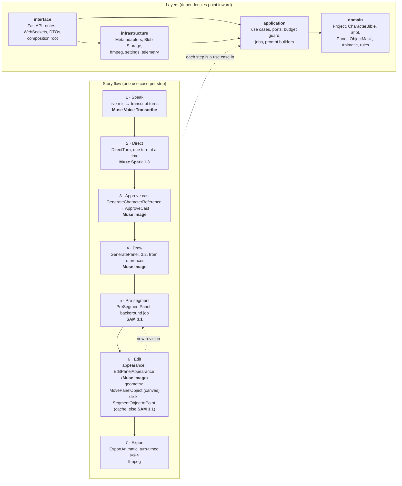

# Architecture

Frameteller's backend follows Clean Architecture ([ADR 0001](adr/0001-clean-architecture.md)): source code dependencies point inward only, and an [import-linter contract](../backend/pyproject.toml) enforces it in CI. The browser never calls Meta APIs; every model call goes through the backend.

## Layers

| Layer | Contains | May import |
|---|---|---|
| `domain/` | Entities, value objects and story rules. Pure Python: no I/O, no frameworks. | nothing |
| `application/` | One use case per intent with `execute()`, the ports they need, the budget guard, job idempotency keys and prompt builders. | `domain` |
| `infrastructure/` | Adapters implementing ports: Meta Model API, Azure Blob Storage, ffmpeg. | `application`, `domain` |
| `interface/` | FastAPI app, WebSocket handlers, Pydantic DTOs, composition root. No business logic. | all of the above |

Domain and application are also forbidden from importing pydantic, FastAPI, the OpenAI SDK, httpx or Azure SDKs.

## Flow and decisions

| Step | Use case | Model | Decision |
|---|---|---|---|
| Speak | (realtime handler) | `muse-voice-transcribe-1.0` | Turn-level timestamps drive panel timing. |
| Direct | `DirectTurn`, `BuildCharacterBible` | `muse-spark-1.3` | One turn at a time with `reasoning_effort: minimal` ([ADR 0002](adr/0002-incremental-direction.md)). |
| Approve cast | `GenerateCharacterReference`, `ApproveCast` | `muse-image-1.0` | No panel before the cast is approved ([ADR 0004](adr/0004-cast-approval.md)). |
| Draw | `GeneratePanel` | `muse-image-1.0` | 3:2 via the Responses API so panels stay editable ([ADR 0003](adr/0003-panel-aspect-ratio.md)). Idempotent on project + shot + revision. |
| Pre-segment | `PreSegmentPanel` | `sam-3.1` | Characters are segmented in the background after each render ([ADR 0006](adr/0006-pre-segmentation.md)). |
| Edit | `EditPanelAppearance`, `MovePanelObject`, `SegmentObjectAtPoint` | `muse-image-1.0`, `sam-3.1` | Geometry on our canvas, appearance by prompt naming every part ([ADR 0005](adr/0005-edits-geometry-vs-appearance.md)). A click hits the mask cache before calling SAM. |
| Reorder | `ReorderShots` | none | Shot numbers stay 1..n. |
| Export | `ExportAnimatic` | none (ffmpeg) | Clips back to back in shot order, each lasting its shot's narration time. |

Every paid call passes the `BudgetGuard` first (per-project and per-day limits), so a refused call costs nothing. Slow work (panels, segmentation, export) runs as jobs keyed by project + shot + revision, so retries never double-charge.

The evidence behind these decisions is in the [Day 2 spike findings](spikes/2026-10-28-findings.md).
