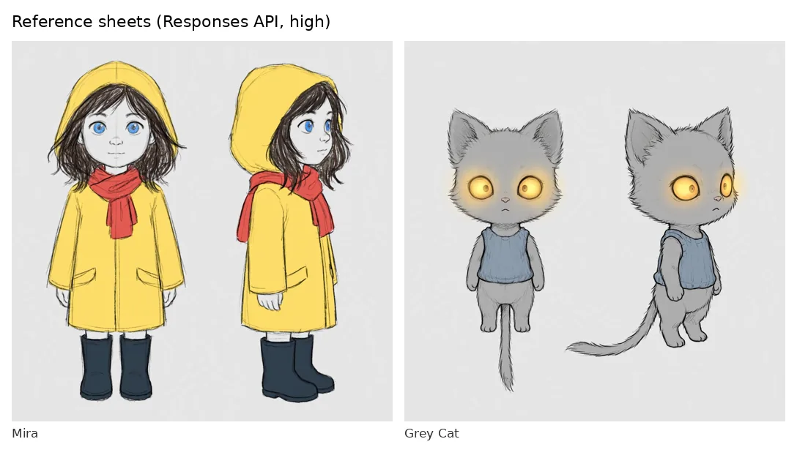
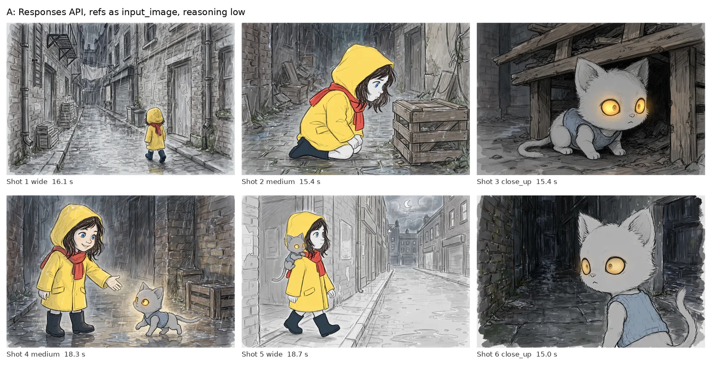
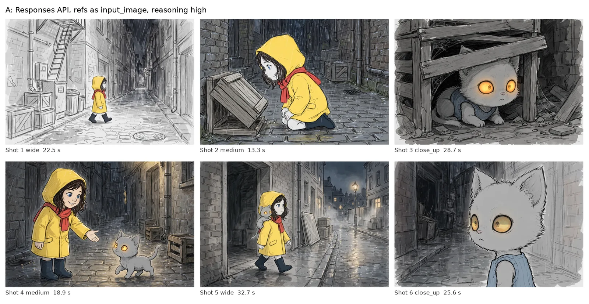
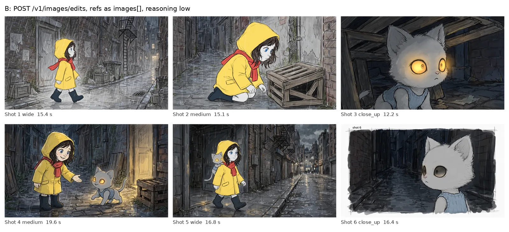
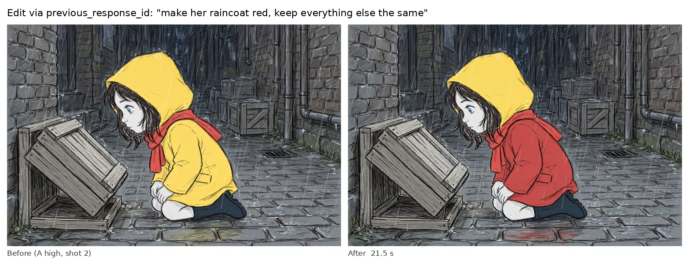
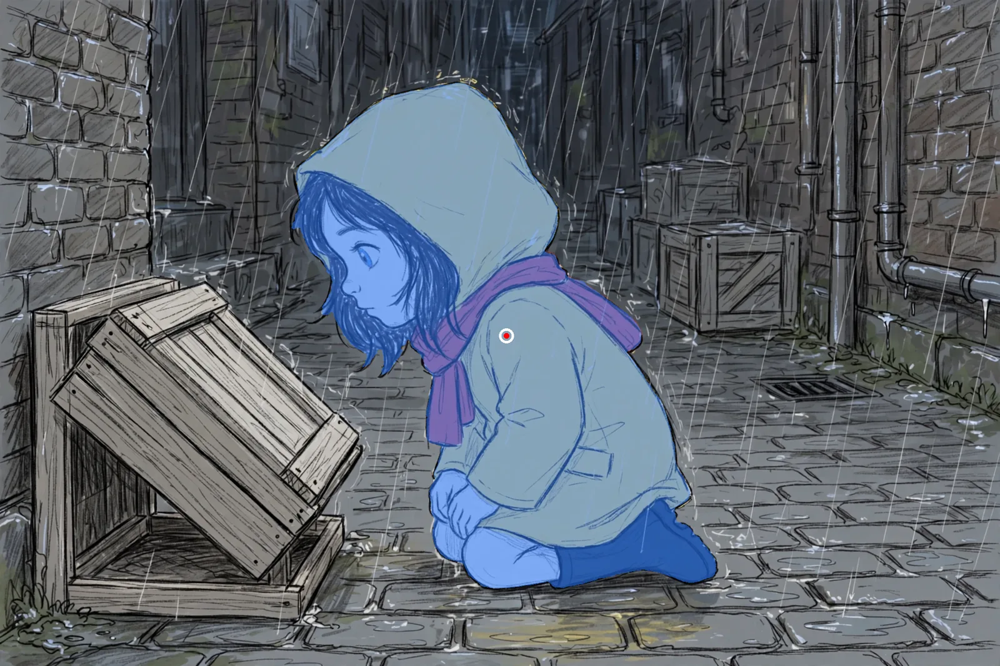
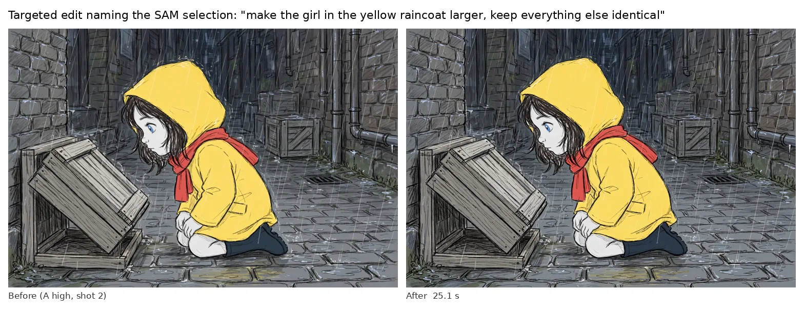

# Day 2 spikes: findings

Run on 2026-10-27 (planned for Oct 28) with plain scripts in [`spikes/`](../../spikes/). Story: the original six-line "Mira and the lantern cat" scene in [`spikes/fixtures/story.txt`](../../spikes/fixtures/story.txt).

**Total spend: $0.2339** of the $2.00 cap (from `spikes/out/costs.jsonl`).

| Spike | Verdict | One line |
|---|---|---|
| 1. Voice → shot list | **GO WITH FALLBACK** | Director is accurate and valid on the first try; voice test still pending. |
| 2. Character consistency | **GO** | Mira and the cat stay on model across 6 panels in every approach. |
| 3. Click → select → edit | **GO WITH FALLBACK** | SAM selection is excellent; prompt edits do appearance well but not size. |

---

## Spike 1: voice to shot list

[`s1_voice_to_shots.py`](../../spikes/s1_voice_to_shots.py)

**Voice: pending.** No `spikes/fixtures/narration.wav` yet, so turns were built from `story.txt` (one per line, 150 wpm) and marked `SYNTHETIC` in the output. The realtime WebSocket and file-transcribe paths are written to the protocol in CLAUDE.md section 5 but have **not been run**.

**Director (muse-spark-1.3-contributor, structured output):**

- Valid `Storyboard` on the **first attempt in both runs** (the retry-with-validation-error path was not needed). 6 shots, 2 characters (`mira`, `cat`).
- Explicit cues honoured: "Wide shot" → `wide`, "Close on the crate" / "Close-up" → `close_up`. `character_ids` only list visible characters (e.g. the cat-only close-ups).
- `duration_ms` matched the turn timings **exactly for all 6 shots**.
- Canonical descriptions were concrete and usable, e.g. *"8-year-old girl … bright yellow hooded raincoat, a red scarf around her neck, and dark rain boots"*.
- Second run produced the same shot count (stable).

| | Run 1 | Run 2 |
|---|---|---|
| Latency | 30.8 s | 22.5 s |
| Input tokens | 958 | 958 |
| Cached tokens | **0** | **0** |
| Output tokens | 3,354 | 2,591 |

**Surprises**

- **No cache hit** on an identical second request. The prompt is ~1k tokens, which is probably under the minimum cacheable prefix. Expect caching to matter only once the system prompt plus character bible is larger; re-check then.
- Output tokens (2.6k–3.4k) are far more than the JSON needs, so most are likely reasoning tokens. That drives the 22–31 s latency.

**Decision / fallback**

- 22–31 s for a whole scene is too slow to feel live if we wait for the full transcript. **Direct incrementally**: show the live transcript immediately, call Spark per finished turn (or small batch) and append shots, keeping the system prompt and bible as the stable prefix.
- Fallback for voice: if realtime ASR misbehaves, record locally and use `POST /v1/asr/transcribe` after the take.

---

## Spike 2: character consistency

[`s2_consistency.py`](../../spikes/s2_consistency.py)

Reference sheets (Responses API, `reasoning_strength: high`, `1024x1024` → 1600×1600 webp):

Six panels three ways, each with the shot's character reference sheets attached:

| | Endpoint | Output size | Latency mean (min–max) |
|---|---|---|---|
| Reference sheets | Responses, high | 1600×1600 | 19.6 s, 25.4 s |
| A low | Responses, refs as `input_image` | 1920×1280 (3:2) | 16.5 s (15.0–18.7) |
| A high | Responses, refs as `input_image` | 1920×1280 (3:2) | 23.6 s (13.3–32.7) |
| B low | `POST /v1/images/edits`, refs as `images[]` | 2016×1152 (7:4) | 15.9 s (12.2–19.6) |

**Basic checks** (consistency is for a human to judge from the sheets above):

- Mira's yellow hooded coat, red scarf, dark boots, dark hair and blue eyes hold in **all 18 panels**.
- The cat holds too, **including a blue knitted vest that the reference sheet invented** (not in the canonical description). References are powerful enough to propagate mistakes.
- The "one accent colour" style is only loosely followed; most panels use yellow, red and blue.
- B shot 6 drew a "shot 6" label and paper border despite "no text … or panel borders".

**Multi-turn edit** (`previous_response_id` on A high shot 2, "make her raincoat red, keep everything else the same", 21.5 s):

The coat body turned red and the puddle reflection followed, but **the hood stayed yellow**. Composition, crate and background are unchanged (measured in spike 3).

**Surprises**

- **The Responses image tool rejects `size: "1792x1024"`** (HTTP 400 "unknown value", also for `16:9`, `1792x1008`, `1920x1080`). `1536x1024` works and gives 3:2. `/v1/images/edits` accepts `1792x1024` and returns 2016×1152. CLAUDE.md section 5 is corrected.
- `/v1/images/edits` returns only `data[].b64_json`, no response id, so its panels cannot continue as a multi-turn edit chain.

**Decision**

- **Approach A** for panels: references as `input_image`, `low` for drafts, `high` for finals, and every panel stays chainable with `previous_response_id`. Panels are 3:2; the animatic centre-crops to 16:9 (1920×1080 from 1920×1280).
- Add a **"approve the cast" step**: show reference sheets for a quick yes/regenerate before drawing panels, since a wrong detail in a reference spreads everywhere.
- B stays a fallback if we need native ~16:9.

---

## Spike 3: click to select

[`s3_sam_click.py`](../../spikes/s3_sam_click.py), on A high shot 2 (1920×1280)

1. Concept prompt "girl in yellow raincoat" → 1 box (569, 161)–(1375, 1129), **7.6 s**.
2. Simulated click at the box centre: `<0f>1<|point;x=972;y=645;w=1920;h=1280|>` (built with `build_object_prompt`), **7.4 s**.
3. Parsed with `meta_sam_parser.parse_responses_stream` + `image_segmentation_format`, decoded with `decode_mask_to_raster`. 1 mask, `one_bit`, 815×972 raster cropped to its box, **430,751 px (17.5% of the panel)**, no parser diagnostics.

The mask covers hood, hair, face, scarf, coat, hands and boots cleanly from a single click. Cut-out saved as a transparent PNG.

**Targeted edit** naming the selection (chained with `previous_response_id`, 25.1 s). Panel 2 has no cat, so the prompt named the selected object instead: "make the girl in the yellow raincoat larger, keep everything else identical".

**Measured stability** (using the SAM mask, grown 12 px; a pixel "changes" if any channel moves by more than 24):

| Edit | Raw change outside selection | Structural change outside (after 6 px blur) | Structural change inside | Size of selection |
|---|---|---|---|---|
| Red coat (spike 2) | 19.7% | **0.6%** | 35.2% | – |
| Larger | 20.7% | **0.1%** | 14.9% | box area **×1.03** |

- The rest of the panel is **structurally stable** (≤ 0.6% changes once fine texture is blurred), but the model redraws rain and pencil texture everywhere, so edits are **not pixel-identical** (~20% of pixels differ).
- Appearance edits work; **size edits barely do** (+3% box area for "larger").

**Decision / fallback**

- SAM click-to-select: **GO** as specified.
- **Geometry by canvas, appearance by prompt.** Move, resize, swap and delete are canvas transforms of the SAM cut-out (react-konva). Colour, clothing and expression changes are chained Muse Image edits naming the object.
- Partial edits (the yellow hood) are fixed with one more chained turn; the UI should make "try again" cheap.
- Because edits re-render texture, composite canvas layers **after** the last prompt edit, or re-run SAM on the edited panel.

---

## Cost

| Spike | Model | Calls | Cost |
|---|---|---|---|
| 1 | muse-spark-1.3-contributor | 2 | $0.0014 |
| 2 + 3 | muse-image-1.0 | 22 | $0.2200 |
| 3 | sam-3.1 | 5 | $0.0125 |
| | | **Total** | **$0.2339** |

The 22 images include the spike 3 edit (logged by the shared spike 2 helper) and one size probe that became A low shot 1. SAM ran 5 times because spike 3 was re-run once to add the size measurement. HTTP 400 rejections are not in the cost log (assumed unbilled; not yet checked against the Billing page).

## Still pending

- [ ] **Real voice test**: record `spikes/fixtures/narration.wav` (mono, 16-bit, 24 kHz) and run spike 1 again to test realtime ASR, turn boundaries and speechEnd → speechComplete latency, and compare with the file endpoint.
- [ ] Prompt caching with a realistic prefix (system prompt plus a full character bible).
- [ ] Account rate limits (3 parallel image calls never hit a 429).
- [ ] How long `previous_response_id` chains stay resumable.
- [ ] Human judgement of consistency from the contact sheets above, and the choice between A low and A high for drafts.
